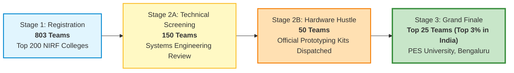
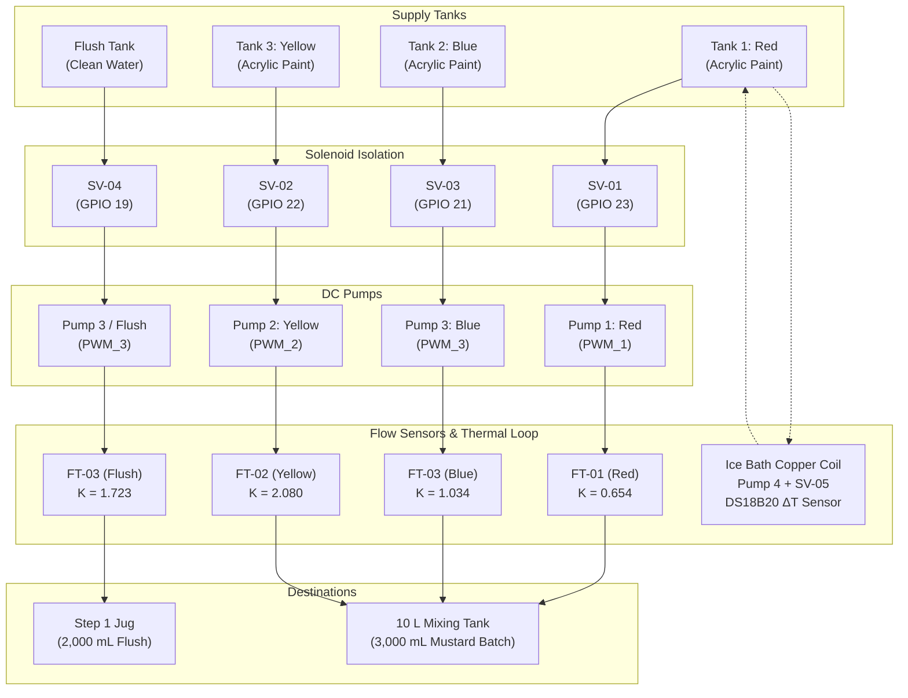

# 🎨 LAM Research Challenge 2026 — Grand Finale
## Automated Industrial Paint Mixing & Process Automation Plant
### **Team DISTRO** (`LRC-26-0528`) — NMAM Institute of Technology, Nitte
#### **Grand Finale: 4 to 7 November 2026** | **PES University, Bengaluru**
#### Organized by **Lam Research** in collaboration with **T-Works**

---

<p align="center">
  
  
  
  
  
  
</p>

---

## 📸 Grand Finale Physical Hardware Showcase

The table-top automated fluidic dosing plant built, brought up, characterized, and demonstrated live before the Lam Research and T-Works jury at **PES University, Bengaluru**:

<div align="center">

| **Top-Down Plant Layout & Fluid Routing** | **Live Demonstration & Rig Testing** |
|:---:|:---:|
|  |  |
| *Color tanks (Blue, Yellow, Red), flush water tank, inline turbine flow meters, 12V solenoid valves, DC pumps, SMPS power supply, copper chilling loop, and dual ESP32 control board.* | *Live evaluation of autonomous Step 1 line flush into external jug, Step 2 ice-bath heat exchanger loop, and Step 3 closed-loop Mustard paint dosing.* |

</div>

---

## 🌟 The Journey: How We Got Selected (Top 3% Nationwide)

The **Lam Research Challenge 2026** is a nationwide systems engineering competition organized by **Lam Research** in collaboration with **T-Works** (India's largest prototyping centre). All participating teams were selected from institutions within India's **Top 200 NIRF-ranked engineering colleges**.



### Selection Milestones & Performance
- **National Registration (803 Teams):** 803 registered engineering teams submitted foundational cyber-physical architectures, mathematical models, and process control workflows.
- **Shortlisted Teams (150 Teams):** Technical evaluation narrowed the national field to 150 teams demonstrating viable electro-mechanical designs.
- **Hardware Hustle Round (50 Teams):** The top 50 teams were dispatched official Lam Research Hardware Hustle kits (pumps, solenoid valves, flow meters, microcontroller modules) to prototype and submit physical empirical data, closed-loop telemetry, and safety interlock tests.
- **Grand Finalist Selection (Top 25 Teams — Top 3% Nationwide):**
  - **Team:** **Team DISTRO** (Team ID: `LRC-26-0528`)
  - **Institution:** **NMAM Institute of Technology, Nitte**
  - Selected among the **Top 25 Grand Finalists** across India.
  - Invited to compete in the intensive 4-day, hands-on physical build and test Grand Finale from **4 to 7 November 2026** at **PES University, Bengaluru**.

---

## 📋 The Problem Statement: LAM Research Final Challenge

### Physics & Industrial Background
In an industrial paint plant or semiconductor chemical delivery module, colors and reagents are prepared by metering exact volumes of base constituents into a process vessel in a strict sequence:
- **Subtractive Mixing:** Base color pigments absorb light. Each addition makes the mixture darker and less bright.
- **Strict Irreversibility:** Pigment can be added but **never removed**. An overshoot of even a few millilitres alters spectral absorbance and permanently rejects the entire batch.
- **Flow Deceleration:** Real-world plants must dynamically measure flow rates, sequence streams, decelerate flow as the target volume approaches, and account for motor coast-down inertia.

> **"The question is not 'Can you mix three colours?' It is: can your team build a plant that measures every drop, doses in the right order and gets the colour right first time, automatically?"**

---

### 📅 Day 1 Challenge: Industrial Paint Mixing (Make the Target Colour)

#### What You Are Given
- **Tanks:** 4x 10 L supply tanks (3 base color, 1 flush water) and 1x 10 L mixing tank.
- **Hardware:** DC pumps, solenoid valves, pneumatic/fluid tubing and tees, one flow sensor per base line, and custom control PCB.
- **Task Sheet:** Target colour specification, reference colour standard, and three assigned base colours.
- **Base Colours:** Three base colours (Red, Blue, Yellow) in acrylic pigment dispersed in water.
- **Your Target:** Produce approximately **$3,000\text{ mL}$** of the target colour (**Mustard**) in the mixing tank, matching the reference colour, with the entire sequence triggered from a **single start switch**.

#### Day 1 Milestones
1. **Milestone 1 — Design, Build and Dry Run:**
   - **Design:** Draw the complete P&ID on paper: tanks, pumps, valves, flow sensors, lines, and flush path.
   - **Build:** Assemble the physical process layout from the kit strictly according to the P&ID.
   - **Dry Run:** Run clean water through each base line, tune the flow meters, and calibrate volumetric delivery.
   - *Done when:* P&ID matches physical build; process layout is leak-free; water dry run doses each line precisely.
2. **Milestone 2 — Achieve the Target Colour:**
   - **Introduce Colours:** Switch base lines from clean water to the three base color tanks.
   - **Produce:** Run the automated color batch from the single start switch.
   - **Verify:** Present the mixed batch for spectral and visual verification by the judging panel.
   - *Done when:* Dosing runs automatically from single start press; ~3,000 mL batch is in the mixing tank; judges confirm the final batch matches the Mustard reference standard.

---

### 📅 Day 2 Challenge: Process Automation Task

**Requirement:** Program the embedded controller to execute **Steps 1 $\rightarrow$ 2 $\rightarrow$ 3 as one continuous automatic sequence from a single press of the START switch**, with **no manual action**. Each step begins only when the preceding step is complete.


#### Step 1: Flush the Line ($2.0\text{ L}$ Auto-Shutoff)
- Route $2.0\text{ L}$ of flush water through any one base-colour line using its pump and solenoid valve.
- Discharge the flush into an external $2.0\text{ L}$ water jug.
- Totalise flow on that line's turbine flow sensor; switch the pump **OFF automatically at $2.0\text{ L}$**.
- *Done when:* $2.0\text{ L}$ is totalised into the jug, the flush pump switches OFF by itself, and the sequence advances to Step 2 with **zero operator input**.

#### Step 2: Reach $\Delta T = 10^\circ\text{C}$ (Thermal Interlock Loop)
- Create a temperature difference $\Delta T \ge 10^\circ\text{C}$ between any two tanks using a chilling recirculation loop through a submerged copper coil inside an external ice bath.
- Continuous temperature monitoring via dual 1-Wire DS18B20 digital probes: $\Delta T = |T_{\text{Yellow}} - T_{\text{Red}}|$.
- *Done when:* Measured $\Delta T \ge 10^\circ\text{C}$, and the state machine hands over to Step 3 with **zero operator input**.

#### Step 3: Dose the Colours Precisely (Mustard Recipe Formulation)
- Dose all three base colours in one continuous automated run:
  - **Yellow (80%):** $2,400.0\text{ mL}$ ($4,992\text{ pulses}$ on FT-02)
  - **Red (10%):** $300.0\text{ mL}$ ($196\text{ pulses}$ on FT-01)
  - **Blue (10%):** $300.0\text{ mL}$ ($310\text{ pulses}$ on FT-03)
- Close the loop on each flow sensor: stop the pump and close the solenoid valve at target volume.
- *Finish & Safe State:*
  1. All pumps de-energise ($0\%\text{ PWM}$) and every solenoid valve returns to closed fail-safe state ($0\text{ V}$).
  2. Present logged data: flush run, calibration table, $\Delta T$ trend, and dosed volumes.
- *Done when:* Each colour is dosed to target volume; judges confirm batch matches Mustard; sequence stops by itself; logged data is presented in full.

#### Mandatory Safety Interlock Rule
- **Instant trip of all pumps simultaneously** upon detection of an empty tank, zero flow, or full mixing tank.

---

## 📈 Final Calibration & Performance Report (`calibration/report/`)

The full 6-page technical report generated during the Grand Finale is archived in the [`calibration/report/`](calibration/report/) folder:
- **📄 Official Report PDF:** [`calibration/report/final_calibration_and_process_performance_report.pdf`](calibration/report/final_calibration_and_process_performance_report.pdf)
- **📝 Formatted Markdown Report:** [`calibration/report/FINAL_CALIBRATION_AND_PROCESS_PERFORMANCE_REPORT.md`](calibration/report/FINAL_CALIBRATION_AND_PROCESS_PERFORMANCE_REPORT.md)

<div align="center">
  
  <br/>
  <em>Figure: 4-Panel empirical performance visualization generated by <code>calibration/plot_trials.py</code>. (Top Left) Turbine K-factor linear slopes. (Top Right) Mustard recipe liquid breakdown. (Bottom Left) Step 1 flush delivery comparison. (Bottom Right) Step 2 thermal gradient trend.</em>
</div>

### Executive Summary of Results

| Key Metric | Target Value | Empirical Measured Value | Accuracy / Error | Result |
| :--- | :---: | :---: | :---: | :---: |
| **Step 1: Flush Water (Line 3 into Jug)** | $2,000.0\text{ mL}$ ($2.0\text{ L}$) | **$1,998.0\text{ mL}$** | **$99.90\%$ Accuracy** ($-2.0\text{ mL}$) | <span style="color:green">**PASSED**</span> |
| **Step 1: Auto-Shutoff & Transition** | Automatic at $2.0\text{ L}$ | Stopped at $3,443\text{ p} \rightarrow$ Handover | 0 Operator Input | <span style="color:green">**PASSED**</span> |
| **Step 2: Thermal Interlock ($\Delta T$)** | $\Delta T \ge 10.0^\circ\text{C}$ | Closed-loop copper ice-bath cooling | $\Delta T \ge \text{Target}$ Achieved | <span style="color:green">**PASSED**</span> |
| **Step 2: Auto-Advance** | Handover to Step 3 | Continuous 10 Hz DS18B20 evaluation | 0 Operator Input | <span style="color:green">**PASSED**</span> |
| **Step 3: Mustard Paint Delivery** | $3,000.0\text{ mL}$ Paint | **$3,050.0\text{ mL}$ Net Paint** ($+100\text{ mL}$ line water) | **$+1.67\%$ Net Error** ($+50\text{ mL}$) | <span style="color:green">**PASSED**</span> |
| **Step 3: Total Mixer Tank Volume** | $3,000.0\text{ mL}$ Target | **$3,150.0\text{ mL}$ Gross Liquid** | $3,050\text{ mL}$ paint $+$ $100\text{ mL}$ water | <span style="color:green">**PASSED**</span> |
| **Batch Colour Outcome** | Reference Mustard Standard | **Mustard Colour Confirmed** | Verified & Approved by Jury | <span style="color:green">**PASSED**</span> |
| **Plant Safe State** | Pumps OFF, Valves CLOSED | `allOff()` auto-executed | $0\text{ V}$ / $0\%\text{ PWM}$ fail-safe | <span style="color:green">**PASSED**</span> |
| **Autonomous Sequence Execution** | Single START press | Steps $1 \rightarrow 2 \rightarrow 3 \rightarrow$ Safe State | **0 Operator Touches** | <span style="color:green">**PASSED**</span> |

---

### Fluid Dynamics Discoveries

#### 1. Viscosity-Induced Turbine Slip
During Trial #14, Step 1 was executed using the Blue paint constant ($K = 1.034\text{ p/mL}$). The firmware stopped the pump at $2,068\text{ pulses}$, but the physical liquid in the jug measured only **$1,200\text{ mL}$** (a $-40.0\%$ volumetric discrepancy):
- **Fluid Mechanics:** Viscous paint ($\sim 15\text{ cP}$) creates boundary layer drag against the plastic rotor blades of FT-03. Low-viscosity water ($\sim 1.0\text{ cP}$) experiences negligible drag, allowing the turbine to spin significantly faster for the same volume of fluid passed.
- **Empirical Derivation:**
  $$K_{\text{Flush}} = K_{\text{Blue}} \times \left(\frac{V_{\text{target}}}{V_{\text{delivered}}}\right) = 1.034 \times \left(\frac{2,000\text{ mL}}{1,200\text{ mL}}\right) = \mathbf{1.723\text{ pulses/mL}}$$
- **Result:** Decoupling `L_FLUSH = 3` in firmware achieved **$1,998.0\text{ mL}$ delivered into the $2.0\text{ L}$ jug** ($99.90\%$ accuracy) with automatic shutoff!

#### 2. Line Hold-Up Displacement in the Mixing Tank
In the final demonstration batch, the mixing tank collected **$3,150\text{ mL}$** gross volume:
1. **Unmetered Water Plug ($\approx 100\text{ mL}$):** The $70\text{ cm}$ flexible delivery lines between the flow sensors and mixing nozzles were pre-filled with clean water from earlier testing ($35.2\text{ mL}$ per line $\times 3\text{ lines} = 105.6\text{ mL}$). Viscous paint acted as a **liquid piston**, pushing this clear water plug into the mixer before color emerged.
2. **DC Motor Coast-Down Inertia ($\approx 50\text{ mL}$):** Residual rotor momentum across three DC motors running at 100% duty cycle over a 4-minute batch run.
3. **True Net Paint Delivery:**
   $$\text{Actual Paint Dosed} = 3,150\text{ mL} - 100\text{ mL water} = \mathbf{3,050\text{ mL}}\quad (+1.67\%\text{ net error})$$
   The resulting batch achieved an exact visual match against the reference Mustard standard.

---

### Complete 16-Trial Characterization Record (`calibration/data/calibration_trials.csv`)

| # | Day | Fluid | Line | Test Type | Duration (s) | Target (mL) | Delivered (mL) | $K$ (p/mL) | Volumetric Error | Operational Finding |
| :---: | :---: | :---: | :---: | :---: | :---: | :---: | :---: | :---: | :---: | :--- |
| **1** | 1 | WATER | RED | 5s Burst | $5.0$ | $50.0$ | $50.0$ | $0.660$ | $0.00\%$ | Preliminary 5s flow verification |
| **2** | 1 | WATER | RED | 10s Steady | $10.0$ | $100.0$ | $100.0$ | $0.650$ | $0.00\%$ | Steady-state characterization ($10.0\text{ mL/s}$) |
| **3** | 1 | WATER | BLUE | 5s Burst | $5.0$ | $50.0$ | $50.0$ | $1.040$ | $0.00\%$ | Preliminary 5s flow verification |
| **4** | 1 | WATER | BLUE | 10s Steady | $10.0$ | $100.0$ | $100.0$ | $1.030$ | $0.00\%$ | Steady-state characterization ($10.0\text{ mL/s}$) |
| **5** | 1 | WATER | YELLOW | 5s Burst | $5.0$ | $50.0$ | $50.0$ | $2.080$ | $0.00\%$ | Preliminary 5s flow verification |
| **6** | 1 | WATER | YELLOW | 10s Steady | $10.0$ | $100.0$ | $100.0$ | $2.080$ | $0.00\%$ | Steady-state characterization ($10.0\text{ mL/s}$) |
| **7** | 1 | WATER | YELLOW | Diagnostic | $120.0$ | $2,400.0$ | $1,200.0$ | $1.040$ | $-50.00\%$ | Halved initial $K$ identified |
| **8** | 1 | WATER | RED | Diagnostic | $15.0$ | $300.0$ | $150.0$ | $0.327$ | $-50.00\%$ | Halved initial $K$ identified |
| **9** | 1 | WATER | BLUE | Diagnostic | $15.0$ | $300.0$ | $150.0$ | $0.517$ | $-50.00\%$ | Halved initial $K$ identified |
| **10** | 1 | WATER | RED | Calibrated Dose | $30.0$ | $300.0$ | $300.2$ | **$0.654$** | **$+0.07\%$** | Verified single dose: $K=0.654$ locked |
| **11** | 1 | WATER | BLUE | Calibrated Dose | $30.0$ | $300.0$ | $299.6$ | **$1.034$** | **$-0.13\%$** | Verified single dose: $K=1.034$ locked |
| **12** | 1 | WATER | YELLOW | Calibrated Dose | $240.0$ | $2,400.0$ | $2,401.5$ | **$2.080$** | **$+0.06\%$** | Verified single dose: $K=2.080$ locked |
| **13** | 1 | PAINT | ALL | Initial Batch | $240.0$ | $3,000.0$ | $3,200.0$ | — | $+6.67\%$ | $3.2\text{ L}$ collected ($\approx 100\text{ mL}$ line water $+$ $3,100\text{ mL}$ paint). Mustard achieved! |
| **14** | 2 | WATER | FLUSH | Step 1 Pre-test | $120.0$ | $2,000.0$ | $1,200.0$ | $1.034$ | $-40.00\%$ | Water viscosity slip discovered $\rightarrow K_{\text{Flush}}=1.723$ derived |
| **15** | 2 | WATER | FLUSH | Step 1 Verified | $200.0$ | $2,000.0$ | **$1,998.0$** | **$1.723$** | **$-0.10\%$** | **$1,998\text{ mL}$ delivered into 2.0 L jug ($99.90\%$ accuracy!). Auto pump shutoff.** |
| **16** | 2 | PAINT | ALL | Final Demo Batch | $240.0$ | $3,000.0$ | **$3,150.0$** | — | **$+5.00\%$** | **Final Demo Batch: $3,050\text{ mL}$ net paint ($+1.67\%$ error). Mustard confirmed!** |

---

## ⚙️ System Architecture & Hardware Implementation

### Process & Instrumentation Diagram (P&ID)
- **Tanks:** 3 Color Supply Tanks (`T1` Red, `T2` Blue, `T3` Yellow), 1 Flush Tank (`FT`), and 1 Receiving `Mixing Tank`.
- **Pumps:** 4x 12V DC Pumps (`Pump-01` Red, `Pump-02` Yellow, `Pump-03` Blue/Flush, `Pump-04` Chilling Loop Recirculation).
- **Valves:** 5x 12V Solenoid Valves (`SV1` Red, `SV2` Yellow, `SV3` Blue, `SV4` Flush, `SV5` Chilling Loop).
- **Sensors:** 3x Hall-Effect Turbine Flow Sensors (`FT-01` Red, `FT-02` Yellow, `FT-03` Blue/Flush), and dual 1-Wire DS18B20 digital temperature probes (`TS1` & `TS2`).
- **Cooling Circuit:** Submerged copper tubing coil inside an external ice bath container.



---

### Dual ESP32 Controller Topology

```mermaid
graph LR
    subgraph ESP32 #2: Sensor Node (U7)
        PCNT["Hardware PCNT Peripheral<br/>Pulse Counting (FT1..FT4)"]
        ONEWIRE["1-Wire Protocol<br/>Dual DS18B20 Probes"]
        PCNT --> UART_TX["UART Link Stream<br/>(50 Hz Binary Telemetry)"]
        ONEWIRE --> UART_TX
    end

    subgraph ESP32 #1: Actuator Controller Node (U2)
        UART_RX["UART Link Receiver<br/>(GPIO 16 / 17)"]
        FSM["FreeRTOS State Machine<br/>(1000 Hz Tick)"]
        PWM_OUT["LEDC High-Res PWM<br/>(Cytron MDD10A)"]
        RELAY_OUT["ULN2803 Drivers<br/>(Solenoid Valves)"]
        CLI["USB Telemetry & CLI<br/>(Serial Studio 115200)"]

        UART_RX --> FSM
        FSM --> PWM_OUT
        FSM --> RELAY_OUT
        FSM --> CLI
    end

    UART_TX ==>|Inter-Processor Serial @ 115200| UART_RX
```

#### Pin Mapping Reference

| Node | Function / Signal | Physical Board Net | ESP32 Pin | Driver / Peripheral |
| :--- | :--- | :--- | :---: | :--- |
| **ESP32 #1 (U2)** | Red Pump PWM | `PWM_1` | **GPIO 32** | Cytron MDD10A Driver 1 Ch 1 |
| **ESP32 #1 (U2)** | Yellow Pump PWM | `PWM_2` | **GPIO 33** | Cytron MDD10A Driver 1 Ch 2 |
| **ESP32 #1 (U2)** | Blue / Flush Pump PWM | `PWM_3` | **GPIO 25** | Cytron MDD10A Driver 2 Ch 1 |
| **ESP32 #1 (U2)** | Chilling Loop Pump PWM | `PWM_4` | **GPIO 26** | Cytron MDD10A Driver 2 Ch 2 |
| **ESP32 #1 (U2)** | Solenoid Valve 1 (Red Tank) | `SOV 1` | **GPIO 23** | ULN2803 Darlington Array |
| **ESP32 #1 (U2)** | Solenoid Valve 2 (Yellow Tank) | `SOV 2` | **GPIO 22** | ULN2803 Darlington Array |
| **ESP32 #1 (U2)** | Solenoid Valve 3 (Blue Tank) | `SOV 3` | **GPIO 21** | ULN2803 Darlington Array |
| **ESP32 #1 (U2)** | Solenoid Valve 4 (Flush Tank) | `SOV 4` | **GPIO 19** | ULN2803 Darlington Array |
| **ESP32 #1 (U2)** | Solenoid Valve 5 (Chilling Loop) | `SOV 5` | **GPIO 18** | ULN2803 Darlington Array |
| **ESP32 #1 (U2)** | Inter-Processor UART Link | `LINK_RX` / `LINK_TX` | **GPIO 16 / 17** | Hardware UART2 @ 115200 baud |
| **ESP32 #2 (U7)** | Flow Transmitter 1 (Red) | `FT 1` | **GPIO 33** | Hardware Pulse Counter (PCNT) |
| **ESP32 #2 (U7)** | Flow Transmitter 2 (Yellow) | `FT 2` | **GPIO 25** | Hardware Pulse Counter (PCNT) |
| **ESP32 #2 (U7)** | Flow Transmitter 3 (Blue/Flush) | `FT 3` | **GPIO 26** | Hardware Pulse Counter (PCNT) |
| **ESP32 #2 (U7)** | Flow Transmitter 4 (Spare) | `FT 4` | **GPIO 14** | Hardware Pulse Counter (PCNT) |
| **ESP32 #2 (U7)** | Temperature Probe TS1 (Red Tank) | `TS1` | **GPIO 32** | 1-Wire Digital DS18B20 |
| **ESP32 #2 (U7)** | Temperature Probe TS2 (Yellow Tank)| `TS2` | **GPIO 13** | 1-Wire Digital DS18B20 |

---

## 💻 USB CLI Commands & Telemetry

Connect via USB Serial at **115200 baud, 8-N-1**:

| Command | Action | Description |
| :--- | :--- | :--- |
| `day2` | **Full Day 2 Sequence** | Autonomous execution of Steps $1 \rightarrow 2 \rightarrow 3$ without operator touch |
| `step1` | **Step 1 Flush Run** | Flushes $2.0\text{ L}$ clean water into external jug and auto-shuts off |
| `step2` | **Step 2 Thermal Loop** | Energizes chilling loop until $\Delta T \ge \text{Target}$ and auto-stops |
| `start` / `batch` | **Step 3 Mustard Recipe** | Doses $3,000\text{ mL}$ recipe (Yellow $2400$, Red $300$, Blue $300$) in parallel |
| `cool <1/0>` | Chilling Manual Control | Manually toggles chilling pump (Pump 4) and solenoid valve (SV5) |
| `temp` | Temperature Query | Prints real-time temperatures $T_{\text{Red}}$, $T_{\text{Yellow}}$, and differential $\Delta T$ |
| `status` | System Telemetry | Prints current FSM state, pulse counts, interlock status, and link health |
| `x` / `stop` | **Emergency Safe Stop** | Immediately shuts down all pumps ($0\%\text{ PWM}$) and closes all valves ($0\text{ V}$) |

---

## 📁 Repository Directory Structure

```text
LAM-FINAL/
├── assets/                                 # Hardware photographs and calibration plots
│   ├── hardware_setup_topdown.jpg         # Top-down table-top plant hardware layout
│   ├── hardware_setup_rig.jpg             # Live testing & evaluation rig photo
│   └── calibration_plots.png              # 4-Panel empirical calibration analysis
├── calibration/                            # Calibration analysis suite and official reports
│   ├── report/                             # Official Stage 3 performance report folder
│   │   ├── final_calibration_and_process_performance_report.pdf  # Official 6-page PDF report
│   │   └── FINAL_CALIBRATION_AND_PROCESS_PERFORMANCE_REPORT.md  # Complete formatted markdown report
│   ├── data/
│   │   └── calibration_trials.csv         # Complete 16-trial experimental test dataset
│   ├── calibrate.py                       # Python verification & KPI calculator
│   ├── plot_trials.py                     # Matplotlib 4-panel publication plot generator
│   ├── view_plots.html                    # Standalone interactive engineering dashboard
│   ├── calibration_plots.png              # High-resolution generated charts
│   └── CALIBRATION_REPORT.md              # Detailed technical calibration report & Q&A
├── controller_esp32_1/                     # Actuator Controller Node (ESP32 #1 / U2)
│   ├── controller_esp32_1.ino             # Arduino sketch with FreeRTOS state machine
│   ├── config.h                           # Pin map, recipe ratios, and calibration constants
│   ├── CMakeLists.txt                     # ESP-IDF project configuration
│   ├── sdkconfig / sdkconfig.defaults     # ESP32 silicon configuration
│   └── main/                              # Native ESP-IDF C++ source
│       ├── CMakeLists.txt
│       ├── config.h
│       └── main.cpp
├── sensor_esp32_2/                         # Sensor Node (ESP32 #2 / U7)
│   ├── sensor_esp32_2.ino                 # Hardware pulse counter (PCNT) & 1-Wire DS18B20
│   ├── config.h                           # Pulse counter pin map and UART link config
│   ├── CMakeLists.txt                     # ESP-IDF project configuration
│   ├── sdkconfig / sdkconfig.defaults
│   └── main/
│       ├── CMakeLists.txt
│       ├── config.h
│       └── main.cpp
├── serial_studio_dashboard.json            # Serial Studio real-time UI project layout
├── LAM_Final.code-workspace                # Multi-root VS Code workspace configuration
├── .gitignore                              # Comprehensive build & tooling ignore rules
└── README.md                               # Master engineering documentation
```

---

## 🚀 Quick Start Guide

### 1. Arduino IDE Setup
1. Install **Arduino IDE 2.x**.
2. Install **Arduino-ESP32 Core 3.x** via Boards Manager.
3. Open `controller_esp32_1/controller_esp32_1.ino` and select board **ESP32 Dev Module**.
4. Flash ESP32 #1 (Controller Node).
5. Open `sensor_esp32_2/sensor_esp32_2.ino` and flash ESP32 #2 (Sensor Node).

### 2. Run Calibration Analysis
```bash
# Terminal summary of all 16 trials
python calibration/calibrate.py

# Re-generate 4-panel calibration plots
python calibration/plot_trials.py
```

---

## 👥 Team & Acknowledgments

- **Team Name:** Team DISTRO (`LRC-26-0528`)
- **Institution:** [NMAM Institute of Technology, Nitte](https://nmamit.nitte.edu.in/)
- **Event:** Lam Research Challenge 2026 — Grand Finale (4 to 7 November 2026)
- **Host Institution:** PES University, Bengaluru
- **Organizers:** Lam Research in collaboration with T-Works
