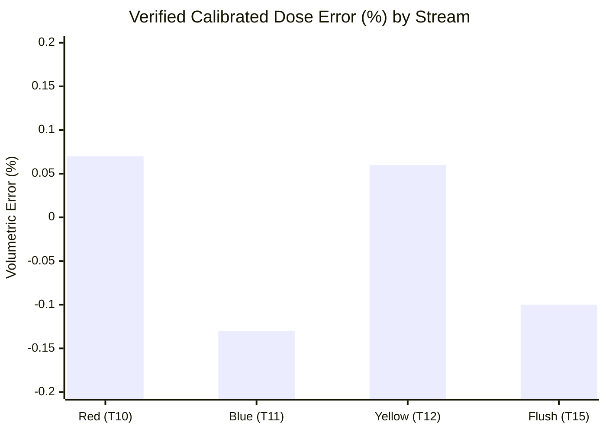

# FINAL CALIBRATION AND PROCESS PERFORMANCE REPORT
## LAM Research Challenge 2026 | Stage 3 | Day 1 and Day 2

> **Evidence Base:** 16 logged trials in `data/calibration_trials.csv`, interpreted alongside the supplied calibration narrative. Values below distinguish measured outcomes from estimates and narrative-only claims.  
> **Source PDF:** [`final_calibration_and_process_performance_report.pdf`](final_calibration_and_process_performance_report.pdf)

---

  
  
  
  

---

## Executive Findings

The calibration sequence corrected large initial under-delivery and produced close final volume agreement in the logged verification runs. The three colour-channel checks (Trials 10–12) had absolute errors of **0.06% – 0.13%**; the dedicated flush-water verification (Trial 15) was **2 mL below its 2,000 mL target**. These are measured water checks; the dataset does not provide independent paint-only calibration runs.

The final mixer batch recorded **3,150 mL** against a **3,000 mL** recipe target (**+5.00% gross**). The report attributes about 100 mL to water displaced from line hold-up, which yields an estimated **3,050 mL paint dose** and **+1.67% net error**. The source log does not measure that water/paint split directly, so the net result is an estimate rather than a directly observed measurement.

### Performance at a Glance

| Stream / Test | Target (mL) | Measured (mL) | Volumetric Error (%) | Performance Status |
| :--- | :---: | :---: | :---: | :---: |
| **Red Line (T10)** | $300\text{ mL}$ | $300.2\text{ mL}$ | **$+0.07\%$** | Verified Calibrated Dose |
| **Blue Line (T11)** | $300\text{ mL}$ | $299.6\text{ mL}$ | **$-0.13\%$** | Verified Calibrated Dose |
| **Yellow Line (T12)** | $2,400\text{ mL}$ | $2,401.5\text{ mL}$ | **$+0.06\%$** | Verified Calibrated Dose |
| **Flush Pre-test (T14)** | $2,000\text{ mL}$ | $1,200.0\text{ mL}$ | **$-40.00\%$** | Uncalibrated (Blue $K$ used) |
| **Flush Verified (T15)** | $2,000\text{ mL}$ | $1,998.0\text{ mL}$ | **$-0.10\%$** | Verified ($K_{\text{Flush}} = 1.723$) |

---

## Overall Assessment

- **Calibration Outcome:** Successful for the measured water runs.
- **Flush Outcome:** **99.90%** of target by physical volume ($1,998\text{ mL}$ in $2.0\text{ L}$ jug).
- **Batch Outcome:** Gross volume above target ($3,150\text{ mL}$); net paint error is **+1.67%** only under the approximately $100\text{ mL}$ line-water displacement assumption.
- **Automation Outcome:** The supplied narrative reports automatic step transitions and safe shutdown, but the CSV alone does not log those events or a temperature trace.

---

## 1. Calibration Results

$K$-factor is calculated as counted pulses divided by measured volume:
$$K = \frac{\text{Pulses}}{\text{Volume (mL)}}$$

The final colour-channel constants were derived from water dosing trials and should be interpreted as calibrated values for those logged conditions.

| Stream / Trial | Pulses | Target (mL) | Measured (mL) | $K$-factor (p/mL) | Error (%) |
| :--- | :---: | :---: | :---: | :---: | :---: |
| **Red / T10** | 196 | 300 | 300.2 | **0.654** | **+0.07%** |
| **Blue / T11** | 310 | 300 | 299.6 | **1.034** | **-0.13%** |
| **Yellow / T12** | 4,992 | 2,400 | 2,401.5 | **2.080** | **+0.06%** |
| **Flush water / T15** | 3,443 | 2,000 | 1,998.0 | **1.723** | **-0.10%** |

### Calibration Progression

| Stage | Evidence | Interpretation |
| :--- | :--- | :--- |
| **Initial Characterization (T1–6)** | 50–100 mL timed runs; 10 mL/s reported across channels. | Baseline pulse counts were near 0.65, 1.03–1.04, and 2.08 p/mL. |
| **Initial Closed-Loop Dose (T7–9)** | All three channels delivered half of target. | $K$ values were effectively doubled in the first dose configuration; recalibration was required. |
| **Verified Channel Doses (T10–12)** | 300.2 / 299.6 / 2,401.5 mL vs 300 / 300 / 2,400 mL. | Absolute errors 0.07%, 0.13%, and 0.06%. |
| **Flush Water Correction (T14–15)** | 1,200 mL at $K=1.034$; then 1,998 mL at $K=1.723$. | Dedicated water constant resolved the 40% under-delivery in the pre-test. |

### Flush Calculation
- **Trial 14:** Measured $1,200\text{ mL}$ after $2,068\text{ pulses}$ while using $1.034\text{ p/mL}$.
  $$\text{Derived Flush Constant} = \frac{2,068\text{ pulses}}{1,200\text{ mL}} = \mathbf{1.723\text{ pulses/mL}}$$
- **Trial 15:** Delivered $1,998\text{ mL}$ from $3,443\text{ pulses}$.
  $$\text{Measured Error} = \frac{1,998 - 2,000}{2,000} \times 100\% = \mathbf{-0.10\%}\quad (-2.0\text{ mL})$$

> The data support a fluid-specific calibration difference for FT-03 under these test conditions. The draft narrative attributes this to viscosity; viscosity is a plausible explanation, but the trials do not isolate viscosity from other setup or operating differences.

---

## 2. Batch Performance and Interpretation

The batch trials record total collected liquid, not separately measured paint and water fractions. The table therefore reports gross volume as observed and net paint volume only as an estimate based on the source narrative’s approximately $100\text{ mL}$ line-water displacement assumption.

| Metric | Target | Day 1 Initial (T13) | Day 2 Demo (T16) |
| :--- | :---: | :---: | :---: |
| **Gross Liquid Collected** | $3,000\text{ mL}$ | $3,200\text{ mL}$ (+6.67%) | **$3,150\text{ mL}$ (+5.00%)** |
| **Estimated Line Water** | $0\text{ mL}$ | $\sim 100\text{ mL}^*$ | $\sim 100\text{ mL}^*$ |
| **Estimated Paint Delivered** | $3,000\text{ mL}$ | $\sim 3,100\text{ mL}$ | **$\sim 3,050\text{ mL}$** |
| **Estimated Net Paint Error** | $0.00\%$ | $+3.33\%$ (+100 mL) | **$+1.67\%$ (+50 mL)** |
| **Pulse Total** | — | 5,498 | 5,498 |
| **Batch Note** | Mustard recipe | Mustard achieved (log) | Mustard confirmed (log) |

*\*Line-water volume is an estimate from the supplied narrative, not a channel measurement in the CSV. The draft estimates 105.6 mL from three 70 cm, 8 mm-ID tubes, then rounds this to about 100 mL for batch decomposition. The paint-only delivery volumes and net errors inherit that assumption.*

### Batch Result Analysis
The Day 2 batch collected $150\text{ mL}$ more than the $3,000\text{ mL}$ total target. If about $100\text{ mL}$ was displaced line water, the estimated paint portion is $3,050\text{ mL}$, $50\text{ mL}$ above target. The available log does not identify per-colour delivered volumes in either batch, so it cannot establish which colour channel contributed the overshoot or verify the 80/10/10 blend in the batch itself.

---

## 3. Complete 16-Trial Record (`calibration_trials.csv`)

| # | Day | Fluid | Line | Test Type | Duration (s) | Pulses | Target (mL) | Actual (mL) | $K$ (p/mL) | Error (%) |
| :---: | :---: | :---: | :---: | :---: | :---: | :---: | :---: | :---: | :---: | :---: |
| **1** | 1 | WATER | RED | timed burst | 5 | 33 | 50 | 50.0 | 0.660 | +0.00% |
| **2** | 1 | WATER | RED | steady run | 10 | 65 | 100 | 100.0 | 0.650 | +0.00% |
| **3** | 1 | WATER | BLUE | timed burst | 5 | 52 | 50 | 50.0 | 1.040 | +0.00% |
| **4** | 1 | WATER | BLUE | steady run | 10 | 103 | 100 | 100.0 | 1.030 | +0.00% |
| **5** | 1 | WATER | YELLOW | timed burst | 5 | 104 | 50 | 50.0 | 2.080 | +0.00% |
| **6** | 1 | WATER | YELLOW | steady run | 10 | 208 | 100 | 100.0 | 2.080 | +0.00% |
| **7** | 1 | WATER | YELLOW | closed loop dose | 120 | 2,496 | 2,400 | 1,200.0 | 1.040 | -50.00% |
| **8** | 1 | WATER | RED | closed loop dose | 15 | 98 | 300 | 150.0 | 0.327 | -50.00% |
| **9** | 1 | WATER | BLUE | closed loop dose | 15 | 155 | 300 | 150.0 | 0.517 | -50.00% |
| **10** | 1 | WATER | RED | calibrated dose | 30 | 196 | 300 | 300.2 | 0.654 | +0.07% |
| **11** | 1 | WATER | BLUE | calibrated dose | 30 | 310 | 300 | 299.6 | 1.034 | -0.13% |
| **12** | 1 | WATER | YELLOW | calibrated dose | 240 | 4,992 | 2,400 | 2,401.5 | 2.080 | +0.06% |
| **13** | 1 | Paint mix | ALL | initial batch | 240 | 5,498 | 3,000 | 3,200.0 | — | +6.67% |
| **14** | 2 | WATER | FLUSH | step1 uncal | 120 | 2,068 | 2,000 | 1,200.0 | 1.034 | -40.00% |
| **15** | 2 | WATER | FLUSH | step1 verified | 200 | 3,443 | 2,000 | 1,998.0 | 1.723 | -0.10% |
| **16** | 2 | Paint mix | ALL | demo batch | 240 | 5,498 | 3,000 | 3,150.0 | — | +5.00% |

### Calculation Notes
- $\text{Volume Error (\%)} = \frac{\text{Actual Volume} - \text{Target Volume}}{\text{Target Volume}} \times 100\%$
- $\text{Accuracy (\%)} = 100\% - |\text{Volume Error (\%)}|$
- $K\text{-factor} = \frac{\text{Pulses}}{\text{Measured Volume}}$
- For trials 13 and 16, CSV reports $K=0.000$ and combined batch volume; this report does not infer individual channel calibration from those totals.

---

## 4. Source Files & Cross References

- **Report PDF:** [`final_calibration_and_process_performance_report.pdf`](final_calibration_and_process_performance_report.pdf)
- **Primary Measurement Data:** [`../data/calibration_trials.csv`](../data/calibration_trials.csv)
- **Calibration Analysis Script:** [`../calibrate.py`](../calibrate.py)
- **Plot Generation Script:** [`../plot_trials.py`](../plot_trials.py)
- **Interactive Web Dashboard:** [`../view_plots.html`](../view_plots.html)
